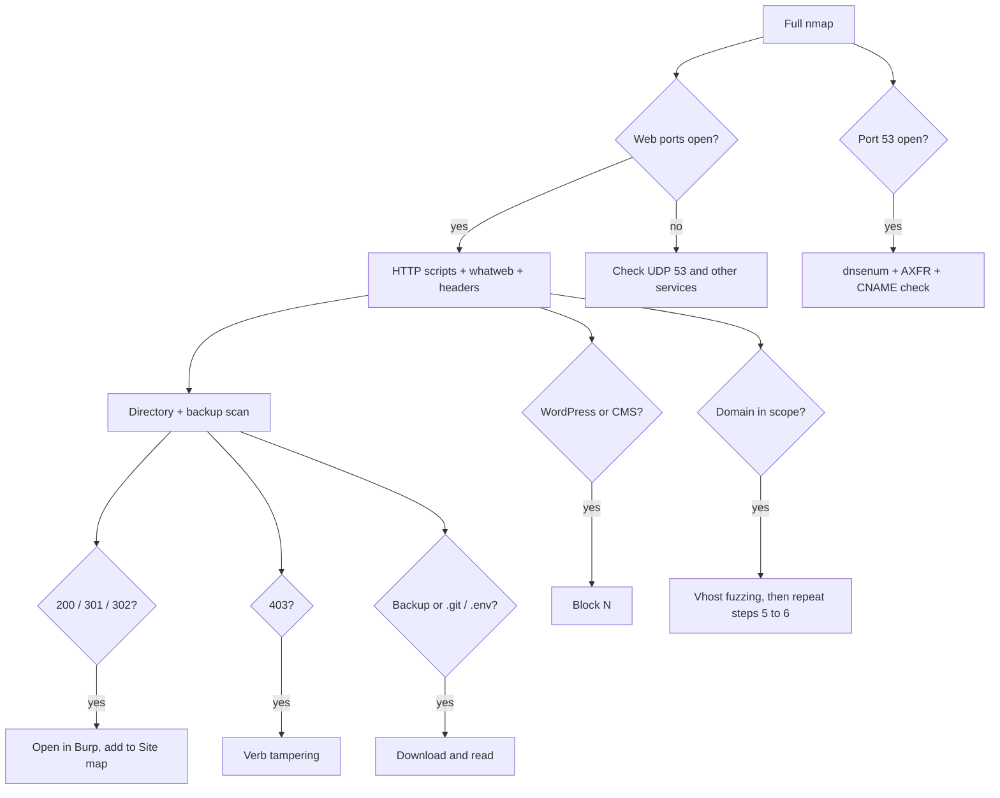

# Phase 1 – Recon Walkthrough

## 1. The goal of recon

Recon answers three questions before any attack:

1. **What is listening?** Open ports and services (`WSTG-CONF-01`).
2. **What web applications exist?** Each web port is a separate host, and each host may have several virtual hosts (`WSTG-INFO-04`).
3. **What does each application expose?** Stack, files, directories, parameters, and entry points (`WSTG-INFO-02` to `INFO-06`, `CONF-02` to `CONF-06`).

Recon produces a **list of targets and leads**. It does not produce findings. Every lead is verified later in Burp.

---

## 2. Concepts you need before running anything

**Ports and services.** A host has 65,535 TCP ports. A service listens on one port. Web apps usually use 80 (HTTP) and 443 (HTTPS), but the exam often uses others (8080, 8000, 8180, 9443). A full scan (`-p-`) checks all of them. A quick scan checks only the common ones and misses the exam's web ports.

**Banners and versions.** `-sV` asks each open port to identify itself. The reply gives the product and version (for example `Apache 2.4.49`). That version is what you search in `searchsploit`.

**DNS and port 53.** DNS is normally **UDP** port 53. The default nmap scan is TCP, so it can miss a DNS server. Run the UDP check (cheatsheet → *Nmap* → `-sU`) when you suspect DNS, or when a question mentions names or zones. Zone transfer (AXFR) needs TCP 53, so a DNS server that allows transfers must answer on TCP.

**Virtual hosts (vhosts) vs subdomains.** A subdomain has a DNS record (`app.target.com`). A vhost is a name the web server answers for, even with no DNS record. Vhost fuzzing sends `Host: FUZZ.<DOMAIN>` straight to `<IP>`, so it works without DNS. That is why it is the primary subdomain tool.

**HTTP status codes in recon.**

| Code | Meaning | Action |
|---|---|---|
| 200 | Exists and is readable | Open in Burp |
| 301 / 302 | Exists and redirects | Follow it, note the target |
| 401 | Exists, needs login (basic auth) | Auth test |
| 403 | Exists, blocked | Verb tampering (block H) |
| 405 | Exists, wrong verb | API or form, try other verbs |
| 500 | Exists, server error | Read the error text, it may leak data |
| 404 | Not found | Ignore |

**Wordlists and fuzzing.** A fuzzer replaces `FUZZ` with each word in a list and sends the request. The list is the limit: a missing word means a missed path. Use the medium list first, then the small list for backups.

**Calibration (`-ac`).** Many servers return the same page for any unknown path (a custom 404 that returns 200). `-ac` measures that default response size and hides matches that look like it. Without `-ac` you get hundreds of false hits.

**Extensions (`-e`).** The stack decides the extension. PHP uses `.php`, ASP.NET uses `.aspx`, Java uses `.jsp`. Whatweb tells you which one, so set `<EXT>` from it.

**Scope and layer 7.** eWPTv2 tests the web application. OS services (SSH, SMB, kernel) are out of scope. Only check them when they leak web files.

---

## 3. Terminals and tabs

Use **three things at once, no more**:

| Where | What | When |
|---|---|---|
| Terminal 1 | Full nmap (`ASYNC`) | Start first, leave it running |
| Terminal 2 | whatweb, headers, HTTP scripts | After nmap gives the web ports |
| Terminal 3 | Directory and backup fuzzing | After whatweb gives `<EXT>` |
| Burp browser | Manual walk (`MANUAL`) | Runs during nmap |

Limits: at most **two fuzzers at once** (the full nmap does not count as a fuzzer). If the VM lags, stop the newest job.

---

## 4. Step by step

### Step 0 – Setup (2 minutes)

1. Create the folder: `mkdir -p recon`.
2. Run the tool and wordlist check from the checklist's *Run order*.
3. If a tool or wordlist is missing, use the fallback in the cheatsheet. Do not install anything.

### Step 1 – Start the full port scan (Terminal 1)

Run the full nmap from block A, in the background. It takes the longest, so start it first.

Why first: every later step depends on the web ports it finds.

### Step 2 – Walk the app in Burp (while nmap runs)

1. Start the Burp browser with the proxy on.
2. Open the root of the target and read the page source (Ctrl+U). Look for comments, hidden fields, and `.js` paths (block J).
3. Browse each link once. Turn Intercept off. Burp records every request in Site map.
4. Open the **Target → Site map**. Note every path, parameter, and `.js` file.

Why now: the browser is idle while nmap runs, and Burp's Site map is your main tool for the rest of the exam.

### Step 3 – Read nmap and build the web port list (Terminal 1, when done)

1. Read the open ports: `grep -E "open" recon/nmap-full-<IP>.txt`.
2. Build `<WEB_PORTS>` with the command in block A.
3. **Check DNS:** is port 53 open? If yes, DNS tests apply (step 7). If no TCP 53, run the UDP check from the cheatsheet before you give up on DNS.
4. Note any FTP, rsync, NFS, or database port. These matter only if they expose web files (block F).

### Step 4 – HTTP scripts on each web port (Terminal 2)

Run the HTTP scripts from block A on `<WEB_PORTS>`.

Read it with `grep "|"`. The output gives you allowed methods (`CONF-06`), directories (`CONF-05`), and robots.txt paths (`INFO-03`). Add each path to Burp scope.

### Step 5 – Fingerprint each web port (Terminal 2)

1. Run whatweb on each port (block D). Set `<EXT>` from the language.
2. Run the headers check (block I). Look for `Server` and `X-Powered-By` with versions.
3. Run `searchsploit` on each product and version.

Why: the stack sets the extension for step 6, and the version sets the known exploits to verify later.

If whatweb shows a CMS, go to block N. If it shows nothing useful, use the verbose error check in block I.

### Step 6 – Directory and backup scans (Terminal 3)

1. Run the directory scan (block C) on the root of each web host. Set `-e <EXT>`.
2. Run the backup scan (block C) on the root.
3. Read the results with the awk line in the checklist, sorted by status.
4. For each `200`, `301`, or `302`, open it in Burp. For each new directory, repeat the scan on it.

Why: the directory scan finds the pages. The backup scan finds the files you should read first (`.bak`, `.sql`, `.zip`).

### Step 7 – Domain-based checks (only if the exam gives `<DOMAIN>`)

1. Run vhost fuzzing (block B). Add each hit to `/etc/hosts` and Burp scope, then repeat step 6 on it.
2. If port 53 is open, run `dnsenum` (block B). It also tries a zone transfer.
3. For each discovered subdomain, check its CNAME (block F).
4. For each subdomain, read the TLS certificate SANs if it answers on HTTPS (block F).

### Step 8 – Targeted probes (as needed)

Run these only when a question or result points to them:

- Web services and APIs (block E) on every web host. Always run it, it is cheap.
- Source control and env files (block G).
- Verb tampering on any `403` path (block H).
- Parameter discovery (block K) when a page reacts to input you cannot see.

### Step 9 – Nikto last, alone

Run nikto (block D) by itself, after every other scan has finished. It is the noisiest tool, and its output is leads only. Verify each lead in Burp before it goes in your notes.

### Step 10 – Completeness pass

1. Check each web port has a checked row: whatweb, headers, directories, backups, web services.
2. Check each `403` has been tested for verbs.
3. Copy `recon/` and your notes to the host PC. A Kali reset wipes them.

---

## 5. Chaining: what each result leads to

---

## 6. Question-driven extras

When a question in the exam mentions one of these, run the matching block. Do not run them otherwise.

| If the question mentions | Run |
|---|---|
| Certificate, SAN, HTTPS name | TLS SANs (block F) |
| Cipher, TLS version, protocol | TLS weaknesses (block F) |
| Subdomain, takeover, CNAME | Dangling CNAME check (block F) |
| Names, zone, DNS records | DNS brute force and AXFR (blocks B and F) |
| HTTP methods, TRACE, OPTIONS | Allowed methods (block H) |
| Security headers, cookie flags | Headers (block I) |
| HSTS | HSTS header (block I) |
| Hidden files, comments, JS | Page content (block J) |
| Admin page, 403 | Admin keywords and verb tampering (block H) |
| Debug, actuator, status page | Debug endpoints (block G) |
| WAF, blocked payload | WAF detection (block O) |
| Third-party hosts, architecture | Architecture map (block O) |
| WordPress, Joomla, Drupal | CMS blocks (block N) and cheatsheet |
| Login, session, cookie | Authenticated re-scan (block M) |
| Public internet exposure | OSINT on the host PC (Appendix B) |

---

## 7. Unexpected events

| What happens | What to do |
|---|---|
| nmap is slow or times out | Use the slow variant in the cheatsheet (`-T3`, host timeout) |
| Fuzzer gives hundreds of hits | The baseline is wrong. Measure it and use `-fs <BASELINE>` instead of `-ac` |
| Fuzzer gives nothing | Check the wordlist path, then try the small list, then the cheatsheet fallback |
| Everything returns 403 | Verb tampering (block H), then the API probe |
| Everything returns 200 | Custom error page. Use `-fs` with the size from the baseline command |
| Tool missing | Cheatsheet → *Wordlist fallbacks* and the substitute tool for that section |
| VM freezes | Stop the newest job (`htop`), then run fewer jobs |
| Port 53 not visible in TCP scan | Run the UDP check. DNS is usually UDP |
| No web ports found | Re-check the full scan output, then the UDP scan, then the non-web services |
| Login page found | Authenticated re-scan (block M) |
| Anonymous FTP shows web files | Non-web services block (F) |

---

## 8. Quick reminders

- Start the slow job first, then do the manual work.
- Read every output with the command in the checklist, not by eye.
- Record each lead with its WSTG ID and the file it came from.
- A lead is not a finding. Verify it in Burp first.
